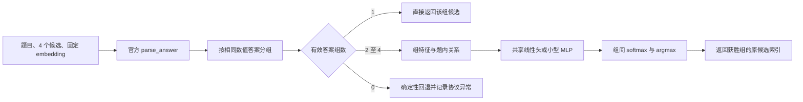

# MP2 最终算法路线：基于答案分组的轻量监督排序

> 状态：可进入实现的方案定稿。本次完成课程复核、代码推导以及 train/validation 输入统计；尚未训练新模型，也未测得新方案准确率或耗时。知识背景、原方案和补充推导见 [课程知识点与方案库](MP2算法知识点总结与方案灵感.md)。规则以 [英文 GUIDE](../guide/GUIDE.md) 为准。

## 1. 最终选择的路线

**使用官方 parser 把四个候选按最终数值答案分组；只有一个有效答案组就直接返回；有多个答案组时，用固定 embedding、票数、文本与局部算术证据，训练一个共享的小型答案组评分器；选出分数最高的组并返回其中任一候选。**

实现顺序固定为：原方法基线 → 跨答案组中心性基线 → 正则化线性组排序器 → 小型 MLP 组排序器 → 有限的特征与损失消融 → 按验证结果选定一个模型 → 导出 NumPy 推理包。

默认不做多模型集成；线性模型作为部署回退方案。MLP 是主增强方案，其最终采用与否由后文的有限选型流程决定，不预先承诺一定超过基线。



## 2. 为什么优先解决答案组之间的选择

### 2.1 当前代码中的 embedding 没有改变得分

根据 [common.py](../code/common.py)，得分只取决于所选候选的 `parse_answer` 值。若候选 A、B 的解析答案相同，选择 A 或 B 得分必然相同。

当前 [submission.py](../code/submission.py) 先按最多票确定一个答案，再在该答案组内部使用 embedding。因此：

- 组内质心、余弦距离或另一个代表候选选择规则，都不会改变它的官方准确率。
- 不同答案组票数相同时，代码通过字典插入顺序选最早出现的组；此时 embedding 没有介入。
- 全部候选都解析失败时，任何候选都不能得分；该分支主要保证程序正常返回。

这意味着新算法必须能在不同解析答案之间改变选择。只改归一化或同组中心性不构成有效的主指标改进。

### 2.2 题库的保证给了两个确定性结论

英文 GUIDE 保证每题至少有一个候选的最终答案正确。因此，对于符合协议的输入：

1. 至少存在一个有效解析答案。
2. 若所有有效解析候选只形成一个答案组，这个组就是正确组，即使另外几个候选无法解析。

测试集的每题至少有两个不同的有效解析答案，所以主要提升空间位于答案冲突问题。不要把“四条一致”的容易题算作模型学会推理的证据。

### 2.3 本次实际读取到的输入结构

统计只读取 train/validation 候选文本与提供的 embedding，复用官方 `load_inputs` 和 `parse_answer`；没有读取 test 输入/参考，也没有用参考答案拟合或打分。题库输入哈希由官方加载函数检查。

| 项目 | Train | Validation |
|---|---:|---:|
| 问题数 | 4,755 | 798 |
| 1 个有效答案组 | 2,641 | 443 |
| 2 个有效答案组 | 1,338 | 227 |
| 3 个有效答案组 | 608 | 108 |
| 4 个有效答案组 | 168 | 20 |
| 需进行组间选择的问题 | **2,114** | **355** |
| 无法解析的候选数 | 871 / 19,020 | 157 / 3,192 |
| 所有候选都无法解析的问题 | 0 | 0 |
| 零 embedding 数量 | 0 | 0 |
| embedding 范数：最小 / 中位数 / 最大 | 48.06 / 57.39 / 73.88 | 46.58 / 57.36 / 72.63 |
| 候选字符数：中位数 / 95% 分位数 | 444 / 875 | 441 / 886.45 |

这解释了为什么模型容量必须克制：用于辨别答案的独立训练问题只有 2,114 道，不能按 19,020 条互相独立的训练样本估算数据量。embedding 也不是单位向量，计算余弦前应显式归一化。

为便于后续分层报告，冲突题的票型分布如下。票型只计有效解析候选，例如 `2+1` 表示另外一条无法解析。

| 有效答案票型 | Train | Validation |
|---|---:|---:|
| 3+1 | 885 | 151 |
| 2+2 | 228 | 34 |
| 2+1+1 | 496 | 88 |
| 1+1+1+1 | 168 | 20 |
| 2+1 | 188 | 28 |
| 1+1+1 | 112 | 20 |
| 1+1 | 37 | 14 |

上述数字是输入结构统计，不是任何算法的准确率。代码注释中的历史成绩也不能替代新的官方评测 JSON。

## 3. 数据定义与训练标签

问题 $i$ 的候选记为 $t_{ij}$，embedding 为 $e_{ij}\in\mathbb R^{1024}$，$j\in\{0,1,2,3\}$。

$$
a_{ij}=\operatorname{parse\_answer}(t_{ij}),\qquad
\mathcal A_i=\{a_{ij}:a_{ij}\ne\mathrm{None}\}
$$

对每个有效答案 $a$，定义答案组：

$$
C_{ia}=\{j:a_{ij}=a\},\qquad n_{ia}=|C_{ia}|,\qquad G_i=|\mathcal A_i|
$$

训练参考也通过官方 parser 得到 $a_i^*$。同题多个候选可能正确，但**正确答案组只有一个**。训练时检查 $a_i^*\in\mathcal A_i$；若不满足应报告数据/协议问题，不能悄悄补一个假标签。

实际约束：

- 解析返回的规范 Fraction 字符串用于分组；不要先转浮点再比较，避免把不同有理数合并。
- 不向模型输入问题 ID、原候选序号、split 标识、答案的词表编号或针对具体题目的查表结果。
- 不为答案值学习独立类别 embedding；数值大小只通过后面定义的有界、通用关系特征出现。
- `None` 候选不进入可获胜答案组，但其数量可作为输入质量特征。
- 训练/验证参考文件只出现在训练或分析工具中；提交函数仅接受传入的 `bank`、`arrays` 和 checkpoint。

## 4. 特征设计：固定为 2,088 维，逐块启用

### 4.1 归一化和组级 embedding

先按候选计算归一化向量，分母设下限以处理零向量：

$$
u_{ij}=\frac{e_{ij}}{\max(\|e_{ij}\|_2,10^{-12})},\qquad
m_{ia}=\frac{1}{n_{ia}}\sum_{j\in C_{ia}}u_{ij}
$$

再计算**每个答案组等权**的题内中心：

$$
c_i=\frac{1}{G_i}\sum_{a\in\mathcal A_i}m_{ia}
$$

采用组等权是为了让重复答案的票数通过显式特征进入，而不是在多个位置无意重复放大。组均值 $m_{ia}$ 不再次归一化，它的范数本身反映组内方向一致程度；需要余弦的地方再单独归一化。

最终输入为：

$$
x_{ia}=[\,m_{ia};\ m_{ia}\odot c_i;\ h_{ia}\,]
\in\mathbb R^{1024+1024+40}
$$

第一块给出该答案组的表示，第二块给出答案组与题内共同语境的交互，第三块是下面定义的 40 个标量。对线性头而言，单独拼接同题相同的 $c_i$ 只增加公共偏置，softmax 后会抵消；交互项才可能改变排序。单独添加 $m_{ia}-c_i$ 与原 $m_{ia}$ 对线性排序也存在冗余，故不作为默认额外 1024 维。

### 4.2 标量特征的精确定义

约定：$V_i$ 为有效候选数；$p_{ia}=n_{ia}/V_i$。所有缺少比较对象的统计返回 0，配合组大小/覆盖特征识别缺失。候选文本按 Unicode 字符计长度；正则词数使用固定规则 `[a-z]+|\d+(?:\.\d+)?`，不冒充模型 token 数。

| 索引 | 特征定义 | 作用 |
|---|---|---|
| 0–1 | $n_{ia}/4$、$n_{ia}/V_i$ | 绝对与有效票数占比 |
| 2 | $\log n_{ia}$ | 可学习的票数先验 |
| 3–4 | $G_i/4$、$V_i/4$ | 冲突数量与有效候选数量 |
| 5 | $(n_{ia}-\max_{b\ne a}n_{ib})/4$ | 与最强对手的票差 |
| 6 | 同题其他答案组中，与本组票数相同的组数 / 3 | 平票结构 |
| 7 | 答案频率熵除以 $\log4$ | 分歧程度 |
| 8–9 | 本组不同候选对的余弦均值、最小值 | 同答案的推理表示一致性 |
| 10–12 | 本组候选与其他有效答案候选间余弦的均值、最大值、最小值 | 跨答案语义接近程度 |
| 13–14 | $\lVert m_{ia}\rVert_2$、$\cos(m_{ia},c_i)$ | 组内聚合程度与题内位置 |
| 15 | 组内原始 embedding 范数的均值 | 将尺度信息与方向分开建模 |
| 16–17 | 候选 $\log(1+\text{字符数})$ 的组内均值、最大值 | 长度与风格 |
| 18–19 | 候选 $\log(1+\text{正则词数})$ 的组内均值、最大值 | 更粗的文本长度 |
| 20–21 | 候选数字字符占比的组内均值、最大值 | 算术文本密度 |
| 22–23 | 重复词 bigram 比例的组内均值、最大值 | 重复/模板化程度 |
| 24–25 | 问题词集合与候选正文词集合 Jaccard 的组内均值、最大值 | 粗粒度题目关联 |
| 26–27 | 题目数字字面量在候选正文中的覆盖比例，取组内均值、最大值 | 条件数字覆盖 |
| 28 | 本组答案是否等于题目中的一个数字字面量 | 防止直接复制题目数字的倾向，方向由训练学习 |
| 29 | 答案除以题目数字尺度后的有符号 log 变换 | 通用数值尺度关系 |
| 30 | 题目有百分比标记 × 答案为非整数 | 数值类型与题型交互 |
| 31 | 题目含固定计数词组 × 答案为非整数 | 计数语境交互，不能作为硬否决 |
| 32–33 | 成功检查的纯数值等式数量的 $\log(1+\text{数量})$，取均值、最大值 | 算术证据数量 |
| 34–35 | 已检查等式中的通过率，取均值、最大值 | 局部计算一致性 |
| 36–37 | 已检查等式中的矛盾率，取均值、最大值 | 局部计算冲突 |
| 38–39 | 是否存在至少一条成功检查的等式，取均值、最大值 | 区分未知与已检查 |

补充约定：

- 余弦分母同样设 $10^{-12}$ 下限；任一向量为零时余弦为 0。余弦矩阵要显式去掉自身对角线；组内不足两条时，内部 pair 特征为 0。
- 第 7 维为 $-\sum_b p_{ib}\log p_{ib}/\log4$。第 3、4、7 维在同题各组间相同，对线性排序直接抵消；保留它们是为了让 MLP 学习题型与组证据的交互。
- 重复 bigram 比例为 `1 - 不同 bigram 数 / bigram 总数`；不足两个词为 0。
- 正则词数和 bigram 都先将文本转为小写；数字字符占比使用 ASCII 数字字符数除以总字符数，空文本返回 0。
- 正文指移除官方最终答案段后的文字：有 `####` 则去掉最后一个该标记及其后内容；否则去掉官方正则匹配的最后一个 boxed 片段。原始文本保留给官方 parser。
- 问题词集合用小写英文字母单词，不拟合外部词典；Jaccard 分母为 0 时返回 0。
- 数字抽取在问题或正文上使用官方数字正则 `[-+]?\d[\d,]*(?:\.\d+)?(?:/\d+)?` 搜索，去逗号后交给 Fraction，转换失败则跳过；去重后得到数值集合。覆盖率为问题数值集合与正文数值集合交集的大小除以问题数值集合大小，问题无数字时返回 0。这只描述字面量匹配，不能判断数值是否被正确使用，也不能完整解释百分比、科学计数法或单位。
- 第 29 维：取题目数字绝对值的最大值与 1 中较大者作为尺度 $M$；令 $r=\operatorname{clip}(a/M,-10^6,10^6)$，特征为 $\operatorname{sign}(r)\log(1+|r|)$。先按 Fraction 有界化再转浮点，题目没有数字时 $M=1$。
- 第 30 维的固定触发词为 `%`、`percent`、`percentage`；第 31 维为 `how many`、`number of`、`total number`。这些只是待检验的弱特征，可能存在反例。

分阶段启用：第一版只开 0–15 与两个 embedding 块；加入 16–31 作为文本/题目关系版本；最后单独加入 32–39。未启用特征固定置零，配置记录 feature mask。这样共享输入格式但仍能判断每块的增益。

### 4.3 有限的算术检查器

这是 Lecture 5 verifier 与 ReAct 工具思想的局部迁移。只检查候选中已经写出的等式，不生成新答案、不修改官方 parser。

第一版仅接受三种明确边界中的**纯数字等式**：`<< ... >>` 内部、成对美元符号包围的行内/独立数学片段内部、整行只含数字表达式与等号。两侧只允许十进制数字、小数点、空格、括号、正负号、加减乘除；统一 `×`/`÷` 后解析。相同文本区间只检查一次。出现变量、单位、指数、函数、多个等号或不支持语法时标记未知，避免从“x + 3 = 5”截出局部片段伪造检查。

使用受限语法树和 Fraction 计算，十进制字面量从原始字符串构造 Fraction，避免经过二进制浮点；不执行候选文本，不使用任意 `eval`。预先固定每候选最多 64 个等式、单侧表达式最多 128 字符、语法树最多 63 个节点/12 层、数字字面量最多 24 位。每个中间结果的绝对值不得超过 $10^{12}$，约分后的分子绝对值与分母均不得超过 $10^{24}$。超限或除零记为未知。

对于成功计算的两侧 $l,r$，以 $|l-r|\le 10^{-6}\max(1,|l|,|r|)$ 为通过条件，容纳少量中间小数舍入。这个容差只用于辅助特征，最终答案仍由官方 Fraction 规则严格评分。没有可检查等式时，通过率、矛盾率都设 0，覆盖标志为 0。

算术检查的结果不会直接否决整个答案组。过程存在错误却最终答案正确时，仍须尊重最终答案标签。报告同时给检查覆盖率及运行时间；若覆盖低或验证无增益，停用该块。

### 4.4 特征标准化

几何特征先在归一化 embedding 上计算，再对完整 $x$ 做训练集统计标准化。统计仅来自用于训练排序器的冲突问题；拟合均值/方差时，同题每组权重设为 $1/G_i$，使每题总权重相同；每个交叉验证 fold 独立拟合。

标准差小于 $10^{-6}$ 的维度视作常量并置零，其他维度标准化后裁剪到 `[-8,8]`。保存均值、尺度、常量掩码、feature mask 和顺序版本。推理不能利用当前题库重新拟合，也不能让某题的输出受同一批其他题目的统计影响。

## 5. 模型与目标函数

### 5.1 线性组排序器：第一个必须完成的监督模型

$$
S_{ia}=w^\top\widetilde{x}_{ia}+b
$$

在同题所有有效答案组上做 softmax，训练目标是正确组的交叉熵。线性模型对权重加 L2 正则；公共偏置 $b$ 对排序会抵消，可省略。用 CPU 的 L-BFGS 优化，初始上限 300 次迭代，正则系数仅比较 $10^{-4},10^{-3},10^{-2}$。

该模型便于观察票数、长度、算术特征的方向，也是比简单中心性更有信息量的监督基线。

### 5.2 主增强模型：共享的两层小 MLP

默认结构：

```text
2088 维输入
→ Linear(2088, 64) → ReLU → Dropout(0.1)
→ Linear(64, 16)   → ReLU
→ Linear(16, 1)
```

所有题目和答案组共用同一组参数，没有“第 0 候选专属权重”。Pooling 与题内 context 均对候选排列对称。输出标量 $S_{ia}$ 只在本题答案组间比较，不直接解释为跨题可比的正确概率。

网络共 **134,753 个参数**，FP32 权重约 **0.514 MiB**；两个 2,088 维标准化向量约 0.016 MiB。掩码、配置和文件头计入后，单模型推理包预期明显小于 1 MiB；这是解析预算，最终仍检查实际资产总量。

### 5.3 主损失：答案组交叉熵

$$
P_{ia}=\frac{\exp S_{ia}}{\sum_{b\in\mathcal A_i}\exp S_{ib}},\qquad
L_{\mathrm{group}}=-\frac{1}{N_{\mathrm{conflict}}}
\sum_{i:G_i\ge2}\log P_{i,a_i^*}
$$

每题权重相同；不按组内候选数量重复计算损失。`G=1` 的损失恒为 0，无组间辨别梯度，训练主排序器时直接跳过。批次用最多 4 组的 mask，对不存在的组屏蔽；softmax 和 log-sum-exp 采用减最大值的稳定实现。

MLP 使用 AdamW 的解耦 weight decay，不能把它写成与自适应优化中的显式 L2 项完全等价。推理关闭 dropout，导出线性层权重与偏置即可用 NumPy 复现前向。

### 5.4 保留的损失与聚合对照

**成对排序**来自 Lecture 6 的 Bradley–Terry 思想，可在同一模型、同一特征下将主损失替换为：

$$
L_{\mathrm{pair}}=
\frac{1}{N_{\mathrm{conflict}}}\sum_{i:G_i\ge2}
\frac{1}{G_i-1}
\sum_{b\ne a_i^*}
\log(1+\exp(S_{ib}-S_{i,a_i^*}))
$$

按题归一化避免答案组多的问题权重变大。无需学习生成策略，名称应为监督成对排序。

**原方案的候选多正例目标**仍可作为对照：

$$
L_i=-\log
\frac{\sum_{j:a_{ij}=a_i^*}\exp s_{ij}}
{\sum_{j:a_{ij}\ne\mathrm{None}}\exp s_{ij}}
$$

但将候选概率简单累加到答案组，等价于组分数使用 log-sum-exp，其中带有隐式票数因子：

$$
\log\sum_{j\in C_{ia}}\exp s_{ij}
=\log n_{ia}
+\log\left(\frac{1}{n_{ia}}\sum_{j\in C_{ia}}\exp s_{ij}\right)
$$

如果以后测试加权投票，可用 log-mean-exp 加显式 $\gamma\log n_{ia}$ 区分“候选质量”与“票数先验”。主线已经包含可学习的票数特征，默认不再叠加另一套手调加权投票。多个相同答案候选的正确事件完全相关，不能用独立事件的 noisy-OR 公式声称得到校准的答案正确率。

## 6. 训练和模型选择：先锁定流程再看结果

### 6.1 数据使用

- 仅从提供的 train 参考构造训练标签；从 2,114 个冲突问题训练主组排序器。
- 在 train 内做 5-fold，以原问题为最小分组单位，按有效答案票型分层，固定种子 7506。同题的候选、答案组、成对样本和增广始终同 fold。
- 每个 fold 的标准化只看该 fold 训练部分；验证部分仅用于评估与早停。
- 训练阶段默认使用 CPU。若改用 GPU，必须满足指南的单卡不超过 RTX 4090 限制。
- 不读取 test 参考来选模型、观察错误后修改方法或调阈值；最终测试成绩只用于冻结后的评分和报告。

### 6.2 初始超参数与搜索上限

| 配置项 | 默认值 / 允许比较 |
|---|---|
| 输入维度 | 2,088，固定 schema，按阶段启用 feature mask |
| MLP 隐层 | 默认 64、16；只额外比较 32、16 |
| 激活 / dropout | ReLU / 第一隐层 0.1 |
| MLP optimizer | AdamW，学习率 $10^{-3}$ |
| MLP weight decay | 0.01 或 0.1 |
| batch size | 64 个问题，而非 64 个候选 |
| epoch 上限 | 150 |
| 早停 | fold 验证冲突题 NLL 连续 15 个 epoch 无改善 |
| 梯度裁剪 | 全局范数 1.0 |
| 线性模型正则 | $10^{-4},10^{-3},10^{-2}$ |
| 随机种子 | 首轮 7506；入选结构复核 7507、7508 |

先固定基础特征，只搜索 3 个线性配置与 4 个 MLP 配置。后续特征/损失消融沿用入选超参数，避免每个消融再大规模调参。三种种子用于检查稳定性，默认不组成集成，也不根据 validation 挑一个幸运种子。

### 6.3 从交叉验证到最终 checkpoint

1. 记录每个配置的 train OOF 冲突题准确率、NLL、各票型表现及所有 fold 成绩。
2. 优先 OOF 冲突题准确率，准确率相同时看 NLL，再看模型体积与复杂度。
3. MLP 最终训练轮数取各 fold 最佳 epoch 的中位数；确定后在全部训练冲突题上重训。线性模型在全部训练冲突题拟合。所有预处理统计重新仅用 train 拟合。
4. 在官方 validation 上比较有限的最终候选：当前基线、入选线性模型、入选 MLP。采用完整验证集准确率最高且满足资源限制的方法；分数相同时优先更简单、更快者。由于单答案题有固定正确出口，同时报告 355 道冲突题结果。
5. 此后冻结模型、配置、依赖、代码版本和文件哈希，再进行 test。若 test 不理想，报告原因和局限，不根据 test 反向重选配置。

验证集只有 355 个冲突问题，少量题的变化可能产生明显百分比差。用题目级 paired bootstrap 报告模型与基线差值区间：固定种子 7506，有放回抽样 2,000 次，取差值分布的 2.5% 与 97.5% 分位数；完整验证集和冲突子集分别抽样。尤其记录“基线错、新模型对”与“基线对、新模型错”的数量；区间与多次选型的局限一起解释，不把小幅波动写成确定改进。

## 7. 最小实验矩阵与研究问题

### 7.1 必做对照

| 编号 | 方法 | 主要回答的问题 |
|---|---|---|
| B0 | 现有 submission.py | 历史方法的可复现基线 |
| B1 | 最多票；仅答案组平票时按跨候选余弦证据选组 | 修复真正的组间平票是否有用 |
| B2 | 按答案组的候选中心性均值排序，不强制多数票 | 中心性单独能否选对答案 |
| L0 | 组间线性模型：embedding、交互、0–15 维 | 监督是否优于无监督中心性 |
| M0 | 同样基础特征的小 MLP | 非线性是否值得额外参数 |
| M1 | 入选模型增加 16–31 维文本/题目关系 | 是否有独立于 embedding 的增益 |
| M2 | M1 增加 32–39 维算术特征 | 局部数值证据是否有效、成本多大 |

B1 的平票比较只在并列最多票组间进行；B2 可以覆盖一个不处于多数的组。候选中心性统一计算为与其他有效候选的平均余弦，排除自身；组分数取组内平均。它们都不需要训练。

### 7.2 关键消融

1. **去票数特征**：观察 learned scorer 是否只是复制多数票；同时注明组 pooling/候选数量仍可能间接带来重复信息，不能声称完全消除了所有 multiplicity 线索。
2. **去 embedding 与交互块**：只保留结构/文本/算术，测量固定表示的贡献。
3. **去题内交互块**：比较独立组表示与相对题内语境的差异。
4. **去长度/重复块（16–23）**：区分风格规律与其他证据。
5. **CE 换成 pairwise loss**：同特征与容量下，比较组分类与成对排序。

若选择“推理文本到底有没有帮助”作为报告主问题，额外补一个严格的**题目 + 最终答案 + 票数**基线，只用 0–7、28–31 等相应特征，不使用全文 embedding 或正文统计。另做 embedding-only 候选模型时，推理必须只输入四个向量，不能偷偷用答案解析排除无效候选；否则应命名为“答案解析 + embedding”。

现有固定 embedding 无法通过删几行文本重新变成“只编码最终答案的 embedding”。对此类无法严格实现的消融，应明确实验实际移除了哪些信息。

### 7.3 每个实验统一记录

- 官方完整验证集 selection accuracy；冲突题准确率及 $G=2,3,4$ 分层结果。
- `3+1`、`2+2`、`2+1+1` 等票型的正确数/总数，避免仅报百分比。
- 覆盖多数票后的“纠错数”和“改错数”；模型与基线的分歧题案例。
- NLL、最高组概率及第一/第二组 margin；置信度分桶中的真实准确率。
- 特征提取、模型前向和完整新进程评测耗时；CPU 型号、总线程上限、推理资产字节数。
- 训练随机种子、配置、fold、训练时长、搜索次数与失败实验。

官方提交依然使用完整 test 的 `accuracy`，不能用筛选后的 hard 子集分数代替。

## 8. 推理流程、确定性与边界

```python
def predict(bank, arrays, checkpoint):
    bundle = load_frozen_bundle(checkpoint)
    result = []
    for row, emb in zip(bank, arrays["embeddings"]):
        groups = group_by_official_parse(row["candidates"])
        if len(groups) == 0:
            result.append(0)  # 全部无效时，官方目标不可达；保证返回合法索引
        elif len(groups) == 1:
            result.append(min(next(iter(groups.values()))))
        else:
            x = build_group_features(row["question"], row["candidates"], emb, groups)
            x = bundle.transform(x)
            scores = bundle.forward_numpy(x)
            answer = choose_group_with_fixed_tie_rule(scores, groups)
            result.append(int(min(groups[answer])))
    return result
```

这是接口伪代码；实际实现先验证 bank/arrays 的数量和形状，避免 `zip` 静默截断。模型前向按多个问题的答案组分块批处理，默认每块最多 128 个问题，减少 Python 调用和临时内存。不能硬编码 N=467；空 bank 返回空列表。

确定性约定：

- 建特征时按规范答案值固定组顺序，不以 gold 排序。
- 同组聚合使用稳定的文本排序；完全相同文本但 embedding 不同的候选可再按向量字节作稳定排序，避免置换导致浮点求和顺序变化。
- 多个组最高分在固定数值容差 $10^{-7}$ 内相同，按规范答案字符串的固定字典序打破平局；这只是完全平局时的可复现规则，不是预测特征。
- 组内返回最小原索引即可。重排候选时索引会改变，应该验证**映射后的候选/解析答案**一致，而不是要求原索引数字不变。
- 官方有限值检查已经提供输入保护；自定义特征仍要处理零范数、空词集、无数字、无可检等式和常量维。
- `checkpoint` 缺失或 schema 不匹配时给出清晰错误，不静默使用另一套权重或回退模型。无训练基线可以独立允许 checkpoint=None。

后续实现至少验证：候选置换等变性、同组代表替换的评分不变性、批次组成不变性、训练框架与 NumPy 前向一致性、含 None/零向量/只有一个组/空 bank 的返回协议。

## 9. 校准与扩展的边界

softmax 分数默认只是相对置信度。若报告需要温度校准，可以在**train 内 OOF logits**上拟合一个正温度，冻结后在 validation 报告 NLL、Brier/ECE 等；不在 test 上拟合。

正温度不改变 argmax，所以校准实验不要声称单独提高 selection accuracy。不同题目的组数不同，应按组数检查校准。OOF 模型与最终重训模型也可能存在概率尺度差异，最终效果以独立 validation 为准。

允许保留的扩展包括 PCA/低秩压缩、简单树模型、显式 log-mean-exp 加权投票、多个模型平均与按票型门控。只有在主线完成、存在可复现互补误差时才启动一个扩展，并重新测量全部运行成本。默认方案已经留足体积空间，无需为了“用满 16 MiB”增加参数。

## 10. 资源预算与部署

### 10.1 推理资产

| 项目 | 默认 MLP 预算 |
|---|---:|
| 网络权重与偏置，FP32 | 539,012 字节，约 0.514 MiB |
| 均值与标准化尺度 | 16,704 字节，约 0.016 MiB |
| 掩码、固定 schema、配置与元信息 | 预留几十 KiB |
| 单模型目标 | 小于 1 MiB |
| 作业硬上限 | 未压缩额外推理资产合计 16 MiB |

以上是参数规模计算，不是实际 checkpoint 测量。资产核算包含所有训练得到的数组、配置、索引与代码内嵌数组；压缩存储不能减免未压缩规模。训练日志、优化器状态与用于分析的 OOF 记录不需要被推理函数载入。

### 10.2 CPU 时间

最多每题 4 个答案组。默认 MLP 每组约 13.5 万次乘加，467 题的最坏情况约 2.5 亿次乘加，另有文本处理与 I/O；不能由这个数字直接保证 30 秒达标。

推理只导入 NumPy、标准库和官方 common；训练框架不进入提交前向路径。运行时总共最多四线程。计时包括新的预测进程和独立评分进程：启动、import、官方哈希检查、数据载入、特征提取、模型前向和输出。

先在 validation 上排查成本；方法冻结后在完整 test 上做官方最终测量。目标留出余量，例如本地完整流程争取低于 20 秒，但资格取决于指南指定的参考 CPU，不能把本地成绩等同于参考机认证。

## 11. 实现文件、命令与交付

### 11.1 待新增文件

本节是实施清单，所列新脚本本次尚未创建。

| 文件 | 责任 |
|---|---|
| `code/group_features.py` | 官方解析分组、固定特征 schema、可选受限算术检查 |
| `code/train_group_ranker.py` | train 标签、按题 CV、训练、OOF、最终 NumPy 权重导出 |
| `code/submission_group_ranker.py` | 只读冻结资源的 `predict`，不导入训练代码 |
| `code/analyze_group_ranker.py` | validation 分层分析、消融结果、错误案例与资源汇总 |
| `code/configs/group_ranker_v1.json` | feature mask、结构、有限搜索空间、种子及协议版本 |
| `code/runs/group_ranker_v1/model.npz` | 前向权重、均值、尺度和掩码 |
| `code/runs/group_ranker_v1/config.json` | 特征版本、结构、确定性规则、训练/输入版本元信息 |
| `code/runs/group_ranker_v1/asset_manifest.json` | 推理资产列表、未压缩规模和哈希 |

复用原 `common.py`、`predict.py`、`score_predictions.py`，不修改官方协议。

### 11.2 实施后的命令模板

以下从 `code/` 目录执行。训练脚本命令是拟定接口，需随实现落地；官方预测与评分命令沿用现有工具。训练依赖另行锁定，推理继续使用仓库固定的 NumPy 依赖。

```bash
export OMP_NUM_THREADS=4
export OPENBLAS_NUM_THREADS=4
export MKL_NUM_THREADS=4

python train_group_ranker.py \
  --config configs/group_ranker_v1.json \
  --output runs/group_ranker_v1

python predict.py --method submission_group_ranker.py \
  --checkpoint runs/group_ranker_v1 --split validation \
  --output runs/validation-group-ranker.json

python score_predictions.py --split validation \
  --predictions runs/validation-group-ranker.json \
  --output runs/validation-group-ranker-score.json
```

冻结之后，使用外部计时包住两个新进程，而不是相加工具内部的部分计时：

```bash
/usr/bin/time -f 'total_wall_seconds=%e' sh -c '
python predict.py --method submission_group_ranker.py \
  --checkpoint runs/group_ranker_v1 --split test \
  --output runs/test-group-ranker.json &&
python score_predictions.py --split test \
  --predictions runs/test-group-ranker.json \
  --output runs/test-group-ranker-score.json
'
```

未来审计题库仍使用同一冻结方法，传入 `--split audit --data-dir /path/to/audit_inputs`；预测不能依赖公开测试集路径、样本数或 ID。

### 11.3 阶段验收

| 阶段 | 完成条件 |
|---|---|
| P0：协议与基线 | 正确构造组标签；验证当前方法与对应最多票基线的评分等价；输出分层统计 |
| P1：基础监督排序 | 线性和小 MLP 均能离线训练、导出、按官方接口运行；无跨 fold 预处理泄漏 |
| P2：文本与算术 | 每个新增特征块都有独立消融与时间记录；无证据的复杂度可关闭 |
| P3：有限选型 | 按预设 OOF/validation 流程选一个配置；完成置换、边界与 NumPy 前向一致性检查 |
| P4：冻结与交付 | 满足体积/线程/时间规则；保存官方成绩、资源记录、代码/权重哈希与复现命令 |

报告最多 10 页，建议围绕一个主问题组织：**学习答案组之间的语义与数值证据，能否在答案冲突题上优于最多票？** 展示基线、主要模型、关键消融、纠错/改错案例、资源成本和泛化限制，并披露实际使用的 AI 辅助及复用内容。

## 12. 课程依据与本项目推导的区分

| 路线决策 | 课程来源 / 本地依据 |
|---|---|
| 最终解析答案作为监督目标 | Lecture 5 p40–59；官方 common.py |
| 同一答案聚合、多路径票数 | Lecture 5 p68；Lecture 6 p18–22 |
| 学习 scorer 选择已有候选 | Lecture 6 p27–34、41 |
| 固定表示加小分类头 | Lecture 4 p12–18 |
| 正确/错误组的成对比较 | Lecture 6 p50–51 |
| 检查长度偏差与 reward proxy | Lecture 6 p34、57 |
| 计算成本与完整测时 | Lecture 5 p34–38；Lecture 6 p20–22；英文 GUIDE |
| 答案组模型、40 维特征、2,088→64→16→1 网络 | **本项目派生设计，尚待实验** |
| 2,114 / 355 道冲突题、当前嵌入分支的评分等价 | **本次本地输入统计与代码推导** |

知识来源文件：[Lecture 3](Lecture%203.pdf)、[Lecture 4](Lecture%204.pdf)、[Lecture 5](Lecture%205.pdf)、[Lecture 6](Lecture%206.pdf)。更完整的课程算法解释、第一版方案与复核修正保存在 [知识点总结](MP2算法知识点总结与方案灵感.md)。
