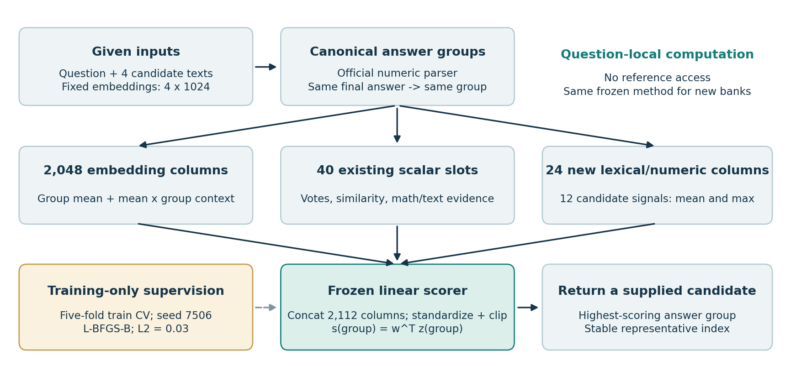
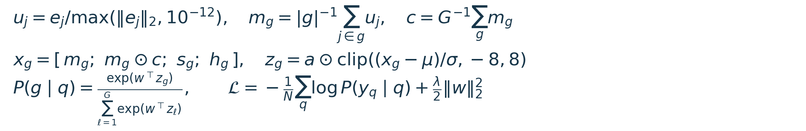
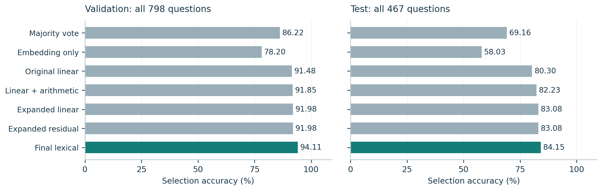
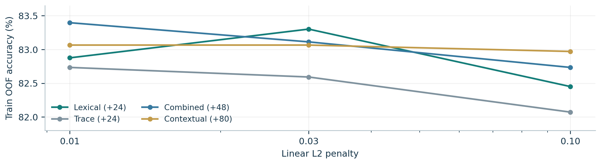

# Compact Answer-Group Ranking for Math Solution Selection

**Author:** li shanghang  
**Student ID:** 3036705979  
**Course:** DASE7506 MP2, Fall 2026

## 1. Algorithm and research question

> Final public-bank selection accuracy: 393/467 = 84.15418%. A 2,112-input linear scorer uses 29,766 bytes of inference assets.

### Task and motivation

Given a mathematics question, four fixed candidate solutions and their 1,024-dimensional representations, the task is to return one candidate index. Any candidate with the correct final numeric answer earns credit; the evaluator does not certify intermediate reasoning. Each supplied question has at least one correct candidate [1].

The central question is whether inexpensive, deterministic evidence from the candidate texts can improve answer selection beyond majority voting and embedding centrality. The design combines agreement, semantic representation and local text/math evidence in a compact scorer. It uses the supplied representations rather than generating new solutions or loading an additional language model.

Figure 1. Inference groups equal parsed answers and scores shared group features. The dashed connection carries train-fitted weights and statistics; references are used only in training.

### Why rank answer groups?

Several candidates can express the same correct value. Treating them as an answer group aligns the prediction unit with the official metric and represents agreement explicitly. A single valid answer group can be selected directly because of the bank guarantee. Otherwise, the system ranks all distinct parsed values and returns the lowest candidate index in the winning group. Unparseable candidates do not create an answer group.

The final model adds 24 group columns derived from 12 lexical/numeric signals. A larger 80-column extension matched its validation count but had lower training OOF accuracy. This supports retaining the smaller system, while the results remain evidence about this course bank rather than a proof of general mathematical reasoning.

## 2. Representation and training objective

### Canonical groups and embedding context

The unchanged official parser uses the last #### suffix, or the last supported flat boxed expression, and canonicalizes the first extracted number with Fraction. Thus equivalent decimals and fractions share a group. For G answer groups, normalize each supplied embedding, average within a group, and form a context that weights each answer group equally. The equations below define the final representation and objective.

Here s_g has 40 existing scalar slots, h_g has 24 new columns, and a disables constant dimensions. The group softmax is used for training; inference selects the maximum score.

| Block | Columns | Construction |
|---|---|---|
| Embedding mean and interaction | 2,048 | Group mean m_g and elementwise product m_g x c. |
| Group statistics | 16 | Vote shares/margins, entropy, within/cross similarity and embedding norms. |
| Arithmetic slots | 8 | Six enabled: step count, invalid fraction, final-step/trace matches, and any-match maxima; two slots remain zero. |
| Earlier text extension | 16 | Mean/max of eight signals: length, numeric diversity, content overlap, equation coverage and trace/number coverage. |
| Final lexical/numeric extension | 24 | Mean/max of the twelve candidate signals summarized below. |

Table 1. Final input layout: 2,048 + 16 + 8 + 16 + 24 = 2,112 columns; 2,110 are active.

| New candidate family | Signals (12 total) |
|---|---|
| Content overlap (4) | Target-sentence recall in body, last three nonempty body lines and last line; question/last-line Jaccard. |
| Units (1) | Recall of fixed target-unit words in the last body line. |
| Format/counts (3) | log1p of body line count, raw equals count and final-answer mentions in body. |
| Numeric priors/diversity (4) | Nonnegative-integer flag; bounded signed log answer; answer/question-max log difference; fraction of novel body numbers. |

Table 2. The final-answer marker is excluded from the body. Fixed regexes, stop words and a small unit vocabulary are used.

### Local arithmetic is evidence, not proof

A bounded recursive-descent parser checks numeric expressions, including fractions, percentages and implicit multiplication, with exact rational arithmetic and tolerance strictly below 1/1000. Unsupported variables, truncated runs and division by zero are skipped. This feature tolerance does not alter the official exact final-answer grading. Correct calculations can still encode the wrong interpretation.

### Optimization and determinism

The final linear model uses group cross-entropy and lambda = 0.03, optimized by CPU L-BFGS-B (maximum 400 iterations). Each training question contributes total standardization weight one, split equally over its valid groups; scaling and constant-column detection are fitted inside each training fold, followed by clipping to [-8,8]. Training optimization uses float64; exported weights/statistics use float32 and scoring uses float64. Members are aggregated in stable text/embedding-byte order, with deterministic score ties.

## 3. Experimental protocol and main results

### Data, supervision and selection

| Split | Questions | Single answer group | Conflicting groups |
|---|---|---|---|
| Train | 4,755 | 2,641 | 2,114 |
| Validation | 798 | 443 | 355 |
| Test | 467 | 0 | 467 |

Table 3. Counts from the unchanged course bank. Fixed embeddings have shape [N,4,1024].

Only training inputs and references fit weights and standardization. The 2,114 conflict questions provide nonzero group-ranking supervision; the other training questions need no learned decision. Five folds keep all groups of a question together and stratify by the answer-vote pattern, using seed 7506. For each final feature variant, L2 in {0.01,0.03,0.10} is selected by train OOF accuracy, then NLL and stronger L2.

The final round required all selected-fold and final optimizers to converge and OOF correct >= 1,745/2,114, the incumbent result. Among eligible models, validation accuracy was primary, followed by OOF accuracy, OOF NLL and parameter count. The chosen lexical checkpoint was frozen before its test evaluation.

| Method | Train OOF | Validation | Test |
|---|---|---|---|
| Majority vote | N/A | 688/798 (86.22%) | 323/467 (69.16%) |
| Embedding only | N/A | 624/798 (78.20%) | 271/467 (58.03%) |
| Original linear | 81.13% | 730/798 (91.48%) | 375/467 (80.30%) |
| Linear + arithmetic | 82.12% | 733/798 (91.85%) | 384/467 (82.23%) |
| Expanded linear | 82.36% | 734/798 (91.98%) | 388/467 (83.08%) |
| Expanded residual | 82.54% | 734/798 (91.98%) | 388/467 (83.08%) |
| Final lexical | 83.30% | 751/798 (94.11%) | 393/467 (84.15%) |

Table 4. Archived results [3]. OOF covers training conflicts; validation/test are complete banks. N/A denotes training-free methods.

Figure 2. Final-answer selection accuracy. The final method gains 70 test questions over voting, 18 over the original linear model, and 5 over the previous expanded residual model.

The final score is 84.1541755888651%, the official scorer's accuracy field. Validation is 751/798 (94.11%); on its conflict subset it is 308/355 (86.76%). Because the complete test contains only conflicts, the full-validation and test percentages describe different difficulty mixtures.

> Historical public test scores were known during subsequent development. Baseline and expanded-linear test scores in Table 4 were added after the final model was frozen, for reporting only. This is not a completely unseen-test experiment; the full development history is discussed in Section 8.

## 4. Feature ablations and unsuccessful ideas

### How much handcrafted expansion is useful?

| Variant | Dim. | L2 | OOF | Val. | Conflict | Fix/loss |
|---|---|---|---|---|---|---|
| Lexical | 2112 | 0.03 | 1761/2114 | 751/798 | 308/355 | 21/4 |
| Arithmetic trace | 2112 | 0.01 | 1749/2114 | 737/798 | 294/355 | 4/1 |
| Combined | 2136 | 0.01 | 1763/2114 | 748/798 | 305/355 | 16/2 |
| Full contextual | 2168 | 0.03 | 1756/2114 | 751/798 | 308/355 | 21/4 |

Table 5. Fix/loss counts are paired against the previous expanded residual model. Only lexical was taken to test in this round.

The lexical block increases validation from 734 to 751 correct. Combined features achieve the highest OOF count (1,763), but only 748 validation correct. The full contextual variant appends group-relative Z scores and vote interactions to all 48 aggregate columns; it ties lexical on validation but has lower OOF (1,756 vs 1,761). The predeclared tie-break therefore selects lexical.

Figure 3. The fixed three-value L2 search uses train OOF only. More columns or weaker regularization do not produce a monotonic gain.

### Earlier experiments that did not justify adoption

Expanded L2 search and block-specific regularization did not beat the six-math-feature model's 733/798 validation result. Two vote/math interactions also tied validation while reducing OOF accuracy. These outcomes were retained in the experiment logs rather than presented as improvements.

A weakly regularized 16-unit residual head reached 737/798 validation but only 79.28% OOF, hit the iteration cap, and scored 376/467 (80.51%) on its frozen test, below the arithmetic model's 384/467. This was an unsuccessful earlier stage. Separate follow-ups predeclared convergence/OOF eligibility before their own training; this is a change in the research protocol, not a rule retrospectively applied to that earlier result.

With stronger regularization, the previous eight-unit expanded residual model scored 388/467. Its hidden/output norms were approximately 0.003 and its validation choices matched expanded linear, so the record does not isolate a nonlinear benefit. The final system consequently keeps a linear scorer.

> These are practical pipeline comparisons, with L2 selected separately for each feature set. They do not establish causal contributions of individual signals. In particular, the lexical improvement also accompanies a change from the previous linear penalty 0.01 to 0.03.

## 5. Validation analysis and uncertainty

### Paired improvements and remaining difficulty

| Compared with | Fixed | Lost | Gain (pp) | 95% bootstrap (pp) |
|---|---|---|---|---|
| Majority vote | 73 | 10 | +7.89 | [5.76, 10.03] |
| Original linear | 28 | 7 | +2.63 | [1.25, 4.01] |
| Expanded residual | 21 | 4 | +2.13 | [0.88, 3.38] |

Table 6. Paired full-validation differences; 2,000 question bootstrap resamples, seed 7506. Intervals are descriptive and unadjusted for model selection.

Relative to the previous residual model, 21 questions are corrected and four are regressed: net +17. The gain interval [0.877,3.383] percentage points excludes zero under this descriptive bootstrap, but validation was also used to select the model. It is therefore not independent confirmation of a generalization effect.

| Distinct groups | Questions | Original linear | Previous residual | Final lexical |
|---|---|---|---|---|
| 1 | 443 | 443/443 | 443/443 | 443/443 (100.00%) |
| 2 | 227 | 200/227 | 203/227 | 209/227 (92.07%) |
| 3 | 108 | 74/108 | 76/108 | 84/108 (77.78%) |
| 4 | 20 | 13/20 | 12/20 | 15/20 (75.00%) |

Table 7. Validation by answer disagreement. All 443 single-group cases are automatically correct under the bank guarantee.

The 47 remaining validation errors are all in conflicting groups. Accuracy falls from 92.07% with two groups to 77.78% with three and 75.00% with four. The four-group subset has only 20 questions; the observed ordering is suggestive rather than a stable estimate for every future bank.

![Figure 4. Post-freeze descriptive calibration on 355 validation conflicts only. Bins are [0,.4), [.4,.6), [.6,.8), [.8,.9), [.9,1]; low-count bins are noisy.](figures/validation_calibration.png)

Figure 4. Post-freeze descriptive calibration on 355 validation conflicts only. Bins are [0,.4), [.4,.6), [.6,.8), [.8,.9), [.9,1]; low-count bins are noisy.

Group softmax confidence is informative but imperfect. The five-bin expected calibration error, sum_b (n_b/355)|accuracy_b-confidence_b|, is 2.95 percentage points. Of 177 conflict questions assigned probability at least 0.9, six are wrong (96.61% accuracy). The lowest bin has only two questions. No probability calibrator, rejection threshold or new test-error rule was fitted during this report analysis.

## 6. What the model learns, and where it fails

### A useful numeric prior is not mathematical understanding

Post-freeze inspection finds 4,752 of 4,755 training references are nonnegative integers, three are negative integers, and none are fractions; all 798 validation references are nonnegative integers. This gives the answer-shape feature a strong empirical basis, but it is a distributional prior rather than a stated guarantee for arbitrary audit inputs.

| New standardized coefficient | Weight |
|---|---|
| Mean nonnegative-integer flag | +0.379 |
| Max nonnegative-integer flag | +0.379 |
| Mean novel-body-number fraction | +0.128 |
| Max novel-body-number fraction | +0.106 |
| Mean target/last-line recall | -0.086 |

Table 8. Selected large coefficients among the 24 new columns, not causal feature importances.

Mean and max answer-only signals are identical within a canonical answer group, creating redundancy in the frozen layout. Correlated features, this duplication and separate regularization choices make coefficient magnitude an unreliable measure of isolated importance. The negative target-recall coefficient also cautions against assuming that more literal word overlap is always helpful.

### Three illustrative validation cases

The following cases were inspected after freezing for explanation only. They are zero-based validation rows; the prediction method never reads their IDs. Prompt summaries below are paraphrases.

| Case | Reference / selected result | Observation |
|---|---|---|
| 38: apples and bananas | Reference 3; previous 4.82; final 3 (p=0.803). | The purchases imply 2x+y=7 and x+y=5. A wrong trace instead uses 12x+y=7. The final choice is correct, but neither this case nor numeric preference proves the scorer solved the equations. |
| 412: garden rows | Reference 150; previous 150; final 160 (p=0.480). | The chosen trace reads 'first 3 rows' as '1st and 3rd rows', then correctly computes 20-(2+2)=16 and 16x10=160. Valid arithmetic supports a mistaken interpretation; the correct calculation is (20-3-2)x10=150. |
| 175: relatives' ages | Reference 14; previous and final 2 (p=0.914). | Three traces reverse the relation that the sister is twice Lexie's age. With Lexie 8, the brother is 2 and the sister 16, so the difference is 14. Agreement among three candidates reinforces the same semantic error. |

Table 9. One corrected case, one regression and one high-confidence persistent error.

The failure pattern is consistent with the design's limits: local numeric checks do not verify the meaning of quantities, modifiers or relationships. Future validation-only work could test unit/entity tracking, written number normalization and controlled removal of answer-shape priors. These remain proposals, not completed results.

## 7. Resources and exact reproduction

### Measured cost and implementation checks

| Item | Recorded final result |
|---|---|
| Local CPU / inference environment | Intel Core Ultra 9 275HX; Python 3.12.3; NumPy 1.26.4. |
| Training environment | CPU; SciPy 1.11.4. Final four-variant search about 91 s; total experiment 97.8 s. |
| Complete fresh prediction + independent scoring | 1.166 s, including startup/imports, hashes, loading and preprocessing. |
| Threads / additional inference assets | Observed total peak 2; documented child limit 3. Three files total 29,766 bytes (29.07 KiB). |
| Stored arrays | Float32 weight/mean/scale and boolean active mask; 27,456 array bytes. NPZ members are uncompressed. |
| Reference-machine eligibility | Not verified on the required Xeon Platinum 8457C; local measurements do not establish eligibility. |

Table 10. Resource claims concern the final local run, not a controlled cross-stage speed comparison. File-cache state was not controlled.

31 unit tests passed. Real validation/test replays, candidate permutations and different batch sizes preserved selected answers; all 822 conflict feature matrices were bitwise identical after candidate permutation. A guard blocking data reopens, cached experiment files, network access and subprocesses still allowed inference. Fixed-configuration retraining reproduced weights, standardization and OOF arrays bitwise in the recorded environment.

### Predict and score without retraining

Run from the repository root with Python 3.12. Use the solution-specific pins; the original course requirements file specifies a different NumPy version. The exact expected accuracy is 84.1541755888651.

~~~bash
cd code
python3 -m venv solution/.venv-inference
solution/.venv-inference/bin/python -m pip install \
  -r solution/residual_ranker/requirements-inference.txt
export OMP_NUM_THREADS=3 OPENBLAS_NUM_THREADS=3
export MKL_NUM_THREADS=3 BLIS_NUM_THREADS=3
solution/.venv-inference/bin/python predict.py \
  --method solution/residual_ranker/extended_submission.py \
  --checkpoint solution/runs/handcrafted_extended_v2/models/lexical/checkpoint \
  --split test --output solution/runs/report_reproduction/predictions.json
solution/.venv-inference/bin/python score_predictions.py --split test \
  --predictions solution/runs/report_reproduction/predictions.json \
  --output solution/runs/report_reproduction/score.json
~~~

### Retrain the fixed configuration and run tests

~~~bash
python3 -m venv solution/.venv-train
solution/.venv-train/bin/python -m pip install -r solution/requirements-train.txt
solution/.venv-train/bin/python -m solution.residual_ranker.extended_train \
  --schemas lexical --l2 0.03 --output solution/runs/report_retrain
solution/.venv-train/bin/python -m unittest discover -s solution -p 'test_*.py'
~~~

The checkpoint must include model.npz, config.json and asset_manifest.json. The final freeze ID and full model/config hashes are listed in report/results.json and the original freeze.json. The frozen model version is answer-group-extended-linear-v1. New runs are Git-ignored, so matching assets must be included in the final release.

~~~text
Model SHA256: ba19ecde764a5a5aed9da6442634e77cfa33b5fa33ff6f474aa23bdc94edf6bd
Config SHA256: b017e7e53d45bf4797e24052aad85437f6a46774854b731c95661c4851a56e44
Code freeze: f77196da60e07a6279161d7c6fed6455d30657eeb757d0c2a2d2aba1239a771a
~~~

## 8. Interpretation, integrity and conclusion

### Experimental history and limits of the claim

Historical test correct counts (out of 467) were: original linear 375; arithmetic 384; optimization replay 384; weak residual 376; expanded residual 388; final lexical 393. Baseline/expanded-linear test comparisons were reporting runs after the final freeze. Failed results and prior decisions remain in their original directories.

The final-round grid and eligibility rules were recorded before its training, and current selection uses train OOF and validation. Nevertheless, earlier public test scores were known while later development continued. A per-round freeze does not erase that history or establish complete test independence. Repeated validation selection also introduces optimism. These results should be treated as public-bank development evidence, with generalization and formal reference-machine eligibility still requiring independent audit.

### Alignment with the assignment

| Requirement | Evidence / boundary |
|---|---|
| Training supervision and fixed benchmark | Only train labels fit parameters; official package hashes match. Predict reads no references; the scorer reads test labels. |
| Offline selection and new inputs | One supplied candidate index; no external data/weights, LLM calls, ID lookup or cached choices. New-bank, ID and synthetic-input checks passed. |
| Limits and reproduction | Local limits passed; four-thread cap required; reference CPU test pending. Matching public code/checkpoint links are still required. |
| Analysis and disclosure | Baseline/ablation/failure/resource evidence is retained. Substantive AI/reuse assistance is disclosed below. |

Table 11. Implementation checks support these statements; they do not adjudicate the full historical development process.

### AI assistance, reuse and data attribution

Codex assisted with design, feature/model code, tests, experiments, analysis, documentation and drafting this report. Python generated the figures and PDF. The submitter remains responsible for understanding, verification and submission. The project reuses course tools/data/representations and its earlier group-ranker functions.

Questions/references derive from the course-provided GSM8K derivative under its retained MIT license. Candidate traces and fixed representations were supplied using Qwen3-0.6B, revision c1899de289a04d12100db370d81485cdf75e47ca; no additional Qwen weights were downloaded. The data LICENSE.txt and NOTICE.txt must accompany redistribution [1,2].

### Conclusion

A compact linear answer-group ranker with deterministic lexical/numeric evidence reaches 84.15418% on the full course test bank, improving on majority voting and the original linear ranker. The useful evidence combines agreement, embeddings and dataset priors; larger expansions and nonlinear capacity did not consistently help. The principal unresolved limitations are semantic reasoning errors, public-bank selection bias and unverified reference-machine performance.

### References and evidence

[1] DASE7506 MP2 course guide and code README, Fall 2026: guide/GUIDE.md; code/README.md. Course bank protocol: dase7506-mp2-open-hard-verifier-v5.

[2] Supplied data provenance: code/data/manifest.json, NOTICE.txt and LICENSE.txt; GSM8K: https://github.com/openai/grade-school-math; Qwen source: https://huggingface.co/Qwen/Qwen3-0.6B.

[3] Evaluation evidence: code/solution/runs/ (the run directories identified in Sections 3-4). Report-derived validation diagnostics and hashes: report/results.json.

