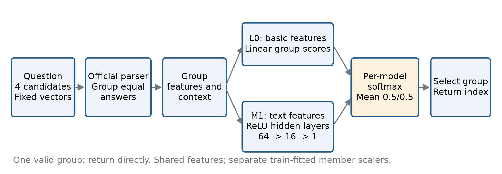
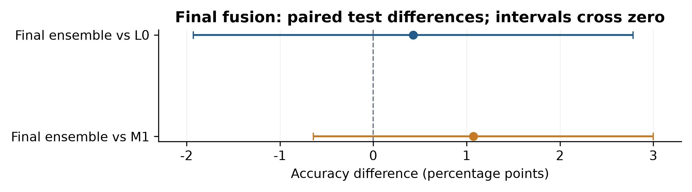
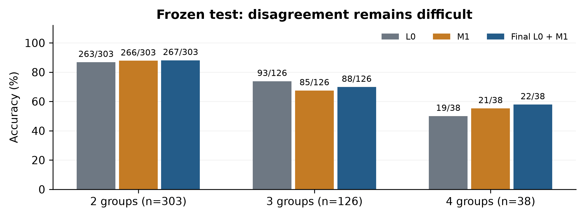
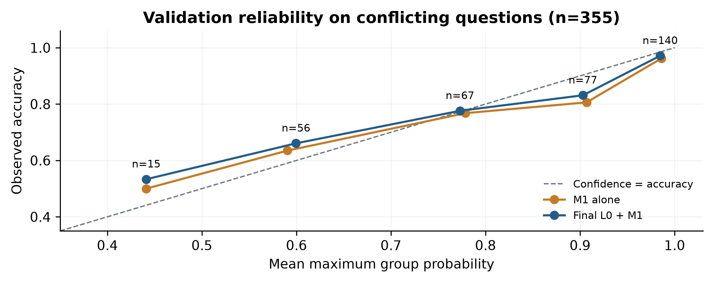

# Selecting LLM Solutions with Linear and MLP Group Ranking

**DASE7506 MP2 Report** | Li Shanghang | Student ID: 3036705979 | 2026-10-21

## 1. Final Method and Research Question

Can a small nonlinear model supply useful evidence beyond a simple supervised answer ranker? The final method, **L0 + M1**, groups equivalent numerical answers, scores each group with a basic linear model and a small text-feature MLP, and averages their probabilities. Our working hypothesis is that complementary errors can improve selection at a small inference cost. The experiments also test whether this expected benefit is consistent across splits. [1-3]

The frozen final method achieves **377/467 test questions, 80.72805139186295%**, with **590639 bytes (0.563 MiB)** of uncompressed inference assets. Historical complete local prediction plus independent scoring takes **0.414 seconds**, at an observed peak of four total threads. Validation is **740/798 (92.73%)**, including **297/355 (83.66%)** conflicting questions. These numbers are saved measurements; this report revision runs no models. [3]



Figure 1. Shared grouping and feature extraction feed two independently normalized scorers. L0 uses basic features; M1 adds text/question evidence. Each branch applies softmax over one question's answer groups, then their probabilities are averaged equally.

### 1.1 Task alignment

The evaluator checks final numerical answers, accepting equivalent fractions and decimals. Several candidates may therefore be correct. Grouping equivalent answers with the official parser gives one target group, preserves votes, and avoids treating an arbitrary correct candidate position as the only target. Prediction returns an existing index from 0 to 3. It neither generates reasoning nor reads reference answers. Supervision concerns final-answer correctness, not every reasoning step. [1,2]

### 1.2 Selection and historical scope

The final submission returns to **ensemble_v1**, the original choice retained by saved validation comparisons. The later attention fusion scores 737 validation and 381 test, versus this method's 740 and 377. Its temporary test-based designation has been withdrawn; it remains an exploratory comparison. The original fusion itself was developed after individual-model test scores had been seen, with its recipe fixed before its own scoring. Restoring the earlier choice does not make that development an independent blind test or erase prior test exposure. Scores and historical records are preserved. [3,7]

<!-- PAGEBREAK -->

## 2. Answer Group Features and Two Scorers

### 2.1 Representation

For each answer group g, normalize its supplied candidate embeddings and average them to form u_g. Let c be the equally weighted mean of all group means in the question. The feature vector contains u_g, its elementwise interaction u_g * c, and scalar evidence. Equal group weighting keeps semantic context separate from explicit vote counts. Stable aggregation and answer-string ordering make candidate rearrangements deterministic. [2]

| Feature block | Dimensions | Information |
|---|---:|---|
| Group embedding u_g | 1024 | Mean normalized embedding of candidates reaching the same numerical answer |
| Context interaction u_g * c | 1024 | Group-specific relation to the competing answers |
| Basic scalars | 16 | Counts, vote shares/margins, entropy, within/cross-group similarities and vector geometry |
| Additional text scalars | 16 | Lightweight candidate style and question/text relations; M1 only |
| Reserved arithmetic scalars | 8 | Disabled in both final branches |

Both models use a 2088-slot schema. L0 enables 2064 coordinates and M1 enables 2080; constant coordinates can be disabled further by the train-fitted scaler. Each member has its own mean, scale and active mask. Standardized values are clipped to [-8,8].

### 2.2 L0: compact supervised scoring

L0 computes a dot product between its weight vector and each standardized basic feature vector. A group softmax converts these scores into a distribution within the question. It minimizes mean target-group cross entropy plus L2/2 times the squared weight norm. The selected L2 is 0.01. Shared weights score all groups; question IDs and candidate positions are not predictive features.

### 2.3 M1: nonlinear combinations of the same evidence

M1 adds text evidence and uses two small hidden layers, 64 and 16 units, with ReLU. Dropout is applied during training and disabled during inference. The final shared head returns one score per group:

```text
X = standardize(group_features, member_scaler)
L0: score = X_basic W_linear
M1: H1 = ReLU(X_text W1 + b1)
    H2 = ReLU(H1 W2 + b2)
    score = H2 W3 + b3
```

M1 stores 134753 scoring weights/biases, and L0 stores 2088: **136841 combined**, before scaler arrays. The final method has no attention block. Candidate relationships enter through context and geometry features; the MLP does not exchange learned value vectors between groups. These are final-answer scorers, not proof validators. [2]

### 2.4 Equal probability fusion and output

For each question, apply softmax separately to the two members' group logits. Compute p(g) = 0.5 p_L0(g) + 0.5 p_M1(g), with temperatures fixed at one. Averaging probabilities avoids assuming identical raw-logit scales. The implementation returns log probabilities to the common ranking function.

Select the highest-probability group and return its smallest candidate index. Near ties use tolerance 1e-7 on log scores and deterministic group order. A single valid group bypasses ranking. No valid groups return candidate index zero, ensuring a valid interface output without a reference lookup. [2]

<!-- PAGEBREAK -->

## 3. Training, Selection and Reproducibility

### 3.1 Train-only fitting and out-of-fold predictions

The supplied bank has 4755 train, 798 validation and 467 test questions. Training scans all train questions; 2641 have only one valid answer group, giving zero group cross entropy. The rankers fit all **2114 conflicting train questions**. Filtering depends on candidate agreement, not test answers or sample identities. [1,2]

Five folds split whole questions, stratified by vote pattern. Each fold fits its own scaler and model using the other four folds, then predicts the held-out train questions. These out-of-fold (OOF) scores support regularization selection, epoch selection and complementarity analysis. No official validation or test references enter fitting. Final models refit all conflicting train questions. [2,3]

| Parameter | Fixed setting |
|---|---|
| L0 regularization selection | L2 in {0.0001,0.001,0.01}; selected 0.01 by train OOF |
| L0 optimizer | L-BFGS-B, at most 300 iterations |
| M1 architecture | 2088 -> 64 -> 16 -> 1; ReLU hidden layers |
| M1 optimizer | AdamW; learning rate 0.001; weight decay 0.01 |
| Batch / regularization | 64 questions; dropout 0.1; gradient norm clipped to 1 |
| Epoch budget / stopping | At most 150 epochs; held-out train-fold NLL patience 15 |
| Final M1 refit | Fold best epochs [5,5,5,3,6]; median gives 5 epochs |
| Seeds | Fold split 7506; M1 fold fit 7506 + fold; final fit 7506 |
| Diagnostic seeds | 7507/7508 for OOF stability only; no seed selection or extra members |
| Ensemble | Fixed equal probabilities; temperature 1; no fusion search or additional fitting |

M1 reuses the architecture and regularization selected in the earlier M0 study while adding text features. Diagnostic M1 OOF accuracy varies across seeds (80.04%, 79.04%, 79.75%). L0 OOF is 81.13%; the final seed remains 7506 despite these differences. The ensemble's seed-7506 OOF is 1717/2114, 81.22%. [3,4]

### 3.2 What supports the final choice?

Saved validation comparisons retain the equal ensemble at 740/798. Calibration and wider ensembles tie this count but use more assets; attention fusion reaches 737/798. The final submission restores this recorded preference. No temperatures, seed choices, new routing rules or weights are added in this revision. The temporary test-based attention choice has been withdrawn. [3,5-7]

The original ensemble recipe was fixed before its own test run, but individual-model test scores were already known. Thus it is a post hoc frozen evaluation, not a clean new blind test. Freezing proves which artifacts produced the score; it cannot remove test-feedback exposure from the development history. An untouched audit bank is needed for a stronger generalization assessment.

### 3.3 Matching sources and environment

The reported 0.414-second run used Python 3.12.3 and NumPy 2.5.3. The current shared environment uses NumPy 1.26.4. Source files also evolved during later experiments. The original **test/source.tar** and freeze manifest identify the historical implementation; the project README extracts this snapshot to reproduce the score with the original checkpoint. Optional retraining uses the current source and does not promise identical bytes across versions. Historical JSON files are not rewritten to match current commands. [3]

<!-- PAGEBREAK -->

## 4. Main Results, Fusion and Exploratory Attention

OOF covers conflicting train questions only. Overall validation includes 443 single-group questions; every test question has conflicting answers. All listed bank scores come from the official scorer. [3,4,7]

| Method | OOF (%) | Validation / 798 | Test / 467 |
|---|---:|---:|---:|
| Original voting baseline | - | 688 (86.22%) | 323 (69.16%) |
| L0 basic linear | 81.13 | 730 (91.48%) | 375 (80.30%) |
| M1 text MLP | 80.04 | 738 (92.48%) | 372 (79.66%) |
| **Final: L0 + M1** | **81.22** | **740 (92.73%)** | **377 (80.73%)** |
| Matched gated control | 77.58 | 727 (91.10%) | 374 (80.09%) |
| Attention alone | 78.48 | 729 (91.35%) | 372 (79.66%) |
| L0 + gated control | 80.51 | 738 (92.48%) | 379 (81.16%) |
| Exploratory L0 + attention | 80.61 | 737 (92.36%) | 381 (81.58%) |

### 4.1 Complementarity creates opportunities, not guarantees

On validation, the final fusion corrects 14 L0 errors and introduces four, net +10, with a paired 95% difference interval [0.25,2.38] percentage points. Against M1, it corrects seven and regresses on five, net +2, interval [-0.63,1.13]. On test, the gains shrink to +2 over L0 and +5 over M1. Both test intervals cross zero. Relative to voting, the fusion gains 52 validation and 54 test questions, but the advantage over strong supervised controls is much smaller. [3]



Figure 2. Frozen test differences: L0 + M1 versus its members. Paired bootstrap intervals use 2000 draws, seed 7506, without multiple-comparison adjustment. Both include zero; the evidence does not establish stable fusion superiority. [3]

Across three diagnostic seeds, M1 rescues 92/96/101 L0 OOF errors; 53 are rescued in all three. On test, fusion corrects 16 L0 errors but introduces 14. Complementary predictions help only when probability averaging favors the right member on a disagreement. The final method uses no oracle routing.

### 4.2 What did the attention control show?

The exploratory encoder uses 64 dimensions, two heads and one block without positions, inspired by attention for sets. An identically parameterized 167233-parameter control gates only its own group's values. Both keep handcrafted context, so the comparison tests additional learned group-value exchange, not fully independent candidate judgment. Attention gains 19 OOF and two validation questions over gating but loses two on test. Its L0 fusion exceeds the final method by four test questions while losing three validation questions; the test difference interval [-0.86,2.57] points includes zero. These mixed observations are reported without replacing the original validation choice. [7,8]

<!-- PAGEBREAK -->

## 5. Reading Reasoning, Style and Candidate Disagreement

### 5.1 Does the model use reasoning, or proxies?

M0 and M1 share the 64/16 MLP architecture; M1 adds 16 lightweight text/question scalars. Validation rises from 733 to 738, while test rises from 369 to 372. This motivates text-derived evidence, but it also includes style and format. No strict full-reasoning versus question-plus-final-answer ablation was completed. The model consumes fixed representations and statistics, not a token-level proof to verify. [4,6]

The following ablations refit the final M1 component with its other training settings unchanged. They do not refit the full ensemble; L0 may compensate differently for removed evidence. [4]

| M1 feature / objective ablation | Validation / 798 | Change from M1 |
|---|---:|---:|
| Full M1 | 738 | 0 |
| Remove vote scalars | 736 | -2 |
| Remove embeddings and geometry | 709 | -29 |
| Remove context interaction vector | 732 | -6 |
| Remove style scalars | 735 | -3 |
| Use pairwise loss | 736 | -2 |

Removing embeddings/geometry has the clearest loss: interval [-5.39,-1.88] points. Other intervals include zero. The style ablation cannot establish style independence, and embedding removal disables multiple related blocks. Adding bounded arithmetic checks gives M2 733 validation and 373 test, versus M1's 738 and 372. Local equation consistency can miss omitted conditions and unit errors, so it is not full reasoning verification.

### 5.2 Does comparing answers expose disagreement?

Embedding-only, B1 tie centrality and B2 group centrality score 624, 677 and 610 validation, below voting's 688. Similarity alone can connect wrong answers on the same topic. Learned models combine votes, geometry and context; the attention control adds an exploratory test of learned interactions. No completely context-free candidate scorer was implemented.



Figure 3. Frozen test strata: 303 two-group, 126 three-group and 38 four-group questions. Final fusion scores 267/303, 88/126 and 22/38. Disagreement is associated with lower accuracy; different problem composition prevents a causal difficulty claim. [3]

L0 outperforms the fusion on three-group questions (93 versus 88); fusion improves four-group accuracy from 19 to 22, with only 38 examples. The method does not dominate its members in every stratum. These descriptive groups do not justify test-derived routing or sample-specific rules.

<!-- PAGEBREAK -->

## 6. Uncertainty and the Value of Additional Computation

### 6.1 Does confidence indicate correctness?

Analysis uses 355 conflicting validation questions. Single-group probabilities are one by construction and would make calibration look easier. The final fusion is correct on 8/15 questions below 0.5 confidence and 136/140 at confidence at least 0.95. At confidence 0.85-0.95, accuracy is 64/77 (83.12%) versus mean confidence 90.30%, showing residual overconfidence. [3,5]



Figure 4. Five display bins for M1 and the final L0 + M1 fusion. Counts label the fusion. The dashed line indicates equality of confidence and accuracy. ECE below uses ten equal-width bins, rather than these five display bins.

| Conflicting validation questions | NLL | Brier | ECE (10 bins) |
|---|---:|---:|---:|
| M1 alone | 0.4781 | 0.2682 | 5.39% |
| Final L0 + M1 | 0.4560 | 0.2613 | 3.38% |
| Calibrated L0 + M1 | 0.4480 | 0.2604 | 4.29% |

NLL measures negative log target probability; Brier sums squared probability errors; ECE aggregates confidence-accuracy gaps. Lower is better, but the metrics need not agree. Fusion improves all three over M1. Train-OOF temperature fitting lowers NLL/Brier further but worsens ECE; it ties 740 validation and uses more assets, so the original ensemble remains the final choice. Its later one-question test gain does not change selection. The method answers every question and uses no abstention. [5]

### 6.2 Do larger networks and alternatives help?

Widening M1 to 128/32 and 256/64 gives 735/733 validation and 364/370 test. Both L0 fusions tie 740 validation but obtain 374/375 test, versus the smaller final method's 377. Increased capacity gives no consistent accuracy benefit in this comparison. Environments differ from the historical control, so timing and width comparisons are not fully controlled causal estimates. [6]

The text-linear variant and calibrated ensemble each score 378 test, with 731 and 740 validation. A 1000-tree model reaches 358 test and 717 validation, versus 352/718 for 300 trees. More computation changes errors without consistently improving validation. Attention fusion reaches 381 test but lower validation, as discussed in Section 4.2. All remain comparisons; the submission retains the original validation preference. [6,7]

<!-- PAGEBREAK -->

## 7. Algorithmic Cost, Engineering Checks and Requirements

### 7.1 Parameter and computational costs

For F=2088 features, G at most four groups and hidden widths h1=64, h2=16, M1 forward cost is O(G(Fh1 + h1h2 + h2)); L0 adds O(GF). Shared feature extraction additionally parses text and computes embedding geometry. The network does not process candidate words as a Transformer sequence. Chunks of at most 128 questions bound intermediate memory. There is no inference-time generation or model download.

| Component / measurement | Recorded value |
|---|---|
| L0 stored scoring parameters | 2088 |
| M1 stored scoring parameters | 134753, including two hidden layers and output head |
| Combined scoring parameters | 136841; scaler arrays and masks counted separately as assets |
| Complete final inference assets | 590639 bytes, 0.563 MiB; all eight files, uncompressed |
| Historical complete test evaluation | 0.414246 s; startup, imports, loading, features, both members and independent score |
| Peak total evaluation threads | 4 = coordinator 1 + child 3; child processes sequential |
| Historical hardware / software | Core Ultra 9 275HX; Linux; Python 3.12.3; NumPy 2.5.3 |
| L0 search and refit | 3 L2 values x 5 folds + refit; 46.23 s |
| Initial M0 search and stability | 20 search fits + 10 diagnostic fits + refit; 307.73 s |
| Fixed M1 OOF and refit | 5 folds + refit; 69.60 s; excludes prior architecture selection |
| Ensemble packaging | 0 fits, no weight search; 0.011 s; excludes member training |

All members, configurations and learned transforms count toward assets. Historical timings have uncontrolled caches and software differences; they are not a strict comparative speed benchmark. The 0.414-second result is a recorded historical run, not a new measurement in the current environment. Reference CPU eligibility remains unverified. [3,6]

### 7.2 Checks and frozen source identity

The saved ensemble checks record 21 passes in the training environment and 20 passes plus one SciPy-dependent skip in the NumPy inference environment. Coverage includes features, gradients, probability fusion, separate scalers, permutations, chunking, boundary inputs and asset integrity. A synthetic two-scaler calculation matches an independent reference exactly. These checks were not rerun for this document revision. [3]

The freeze manifest identifies original assets and the SHA-256 source archive. Later refactors mean current files are not byte-identical to that source; test/source.tar retains the original implementation. The builder verifies the archive and original assets/metadata without rewriting them.

### 7.3 Assignment requirements

The checked implementation uses train-only fitting, supplied data/embeddings, unchanged official parser/scorer, input-driven offline candidate selection and no external weights or ID lookups. It meets the asset limit and recorded local thread limit; training used CPU. The final choice matches the saved validation preference, while prior test exposure remains disclosed. These facts do not establish independent blind-test development. [1-3]

Reference Xeon Platinum 8457C timing remains unverified. This report is within ten pages. Matching sources, checkpoints, official JSON, OOF records and frozen archives are versioned under runs/; environments and temporary files are excluded. Submit a publicly accessible matching repository version. Installation, training and score-reproduction commands are centralized in the project README; fresh installations create only the specified solution/.venv if missing.

<!-- PAGEBREAK -->

## 8. Limitations and Conclusion

### 8.1 Limitations and defensible next steps

**Final answers do not certify reasoning.** A correct number can follow a flawed derivation. Embeddings and style features may reward fluent but incorrect explanations. Group means can hide differences among candidates with identical final answers. A strict question-plus-answer/full-reasoning ablation and step-level verification remain unfinished.

**Improvements over strong controls are small.** Fusion beats voting substantially but gains only two test questions over L0. The corresponding interval includes zero. Feature ablations mostly test the M1 component, and several preserve indirect context/vote signals. The attention comparison also retains handcrafted context and has mixed split outcomes. These results do not prove a stable causal advantage for fusion, attention or deeper reasoning understanding.

**Development history limits independence.** Earlier test scores were already known during exploratory extensions. The final submission restores the original saved validation choice, and the temporary test-based attention designation is withdrawn. That correction does not erase prior exposure or turn the process into a new blind test. Historical scores, sources and selection records remain intact; a fresh untouched audit bank would support a stronger assessment.

**Reference eligibility and access need confirmation.** Local runtime does not establish reference CPU eligibility. Original weights, matching frozen sources and evidence are versioned together; the submitted commit must be publicly accessible. Robustness to other candidate generators, languages and problem sources is untested. Further experiments should commit their train/validation selection procedure before any new audit evaluation.

### 8.2 Conclusion

Answer grouping turns candidate selection into supervised ranking over a small set. L0 provides a compact vote/semantic anchor; M1 adds nonlinear text-feature combinations. Equal probability averaging yields the final **377/467 (80.72805139186295%)** result, with **0.563 MiB** assets and **0.414 s** historical local complete evaluation. Validation supports retaining this original ensemble; its small gains over stronger controls remain uncertain. Attention's higher observed test score is reported as exploratory evidence rather than used to replace the recorded choice.

### References and evidence

[1] [Assignment guide](../guide/GUIDE.md), especially the research questions, resource limits and train/validation/test roles.

[2] Final implementation in group_ranker/: [features](../code/solution/group_ranker/features.py), [text evidence](../code/solution/group_ranker/evidence.py), [MLP](../code/solution/group_ranker/mlp.py), [training tools](../code/solution/group_ranker/training.py), [L0 training](../code/solution/group_ranker/train_linear.py), [M1 training](../code/solution/group_ranker/train_mlp.py) and [ensemble prediction](../code/solution/group_ranker/submission_ensemble.py). Historical source is fixed by [test/source.tar](../code/solution/runs/ensemble_v1/test/source.tar).

[3] Final ensemble records: [preparation](../code/solution/runs/ensemble_v1/preparation.json), [validation selection](../code/solution/runs/ensemble_v1/validation/summary.json), [official test score](../code/solution/runs/ensemble_v1/test/score.json), [analysis/resources](../code/solution/runs/ensemble_v1/test/summary.json), [freeze](../code/solution/runs/ensemble_v1/test/freeze.json), [checks](../code/solution/runs/ensemble_v1/checks.json), [L0 training record](../code/solution/runs/linear_v1/training.json), [M1 training record](../code/solution/runs/mlp_text_v1/training.json).

[4] [P3 ablations](../code/solution/runs/p3/validation/summary.json), including seed stability and component feature/objective comparisons. [5] [Calibration validation](../code/solution/runs/calibrated_ensemble_v1/validation/summary.json).

[6] [Capacity study](../code/solution/runs/mlp_capacity_v1/summary.json), [tree comparison](../code/solution/runs/tree_v2/checks.json), [M0 training](../code/solution/runs/mlp_v1/training.json). Additional official score paths and hashes are listed in evidence.json.

[7] [Exploratory attention study](../code/solution/runs/attention_v1/summary.json), [pre-test validation retention](../code/solution/runs/attention_v1/validation_summary.json). [8] Lee et al. (2019), [Set Transformer](https://proceedings.mlr.press/v97/lee19d.html), ICML, PMLR 97:3744-3753.

Figures read saved records only. build_report.py rebuilds charts, evidence.json and the PDF without training, predicting or scoring. Reproduction commands are in the root README.

### Codex assistance disclosure

OpenAI Codex assisted method discussion, implementation/checks, experiment execution and records, and report/chart preparation. Numbers come from saved records and official scorer JSON. Offline inference makes no Codex or external API calls. The author is responsible for understanding the method, checking evidence and disclosing the development history. Supplied data licenses and attribution are retained.
